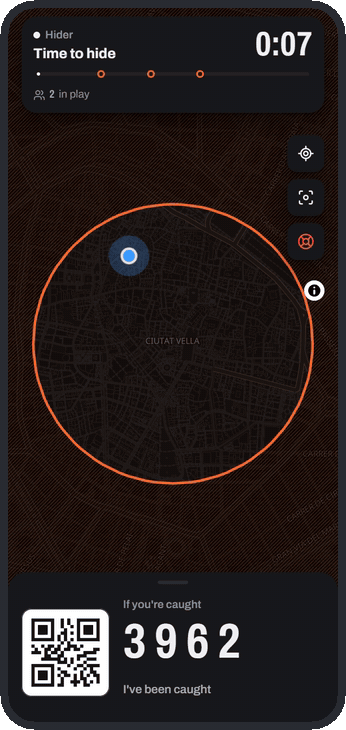
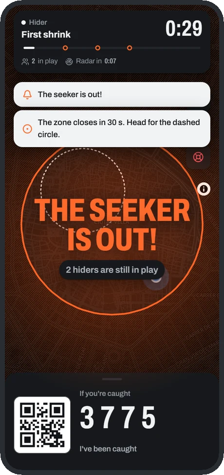
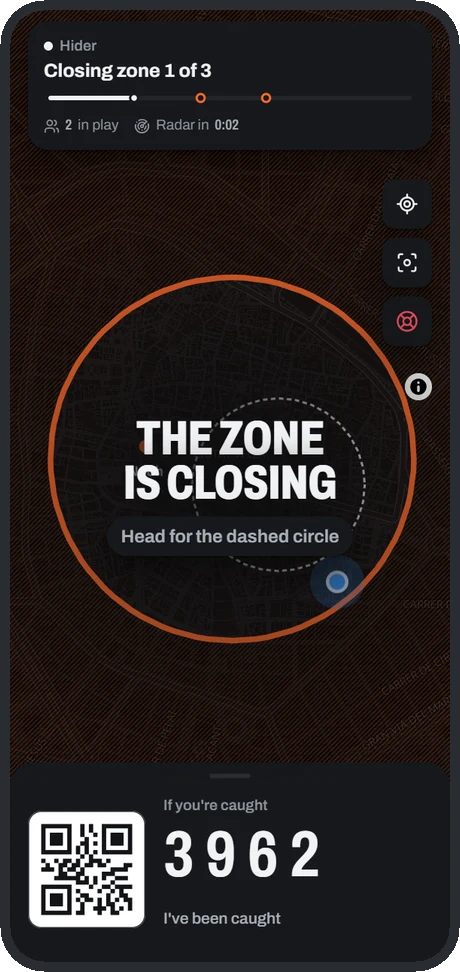
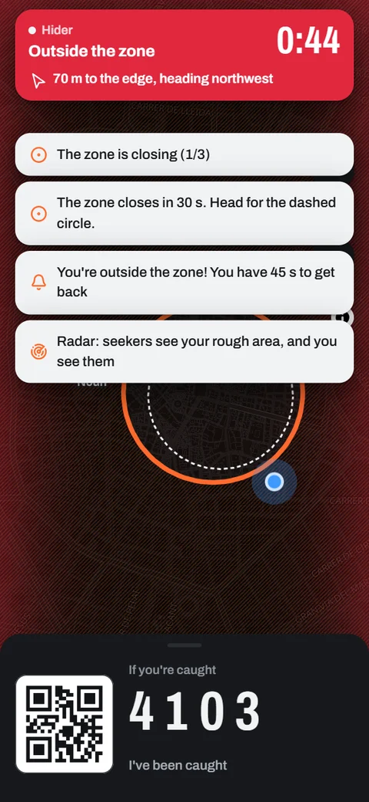
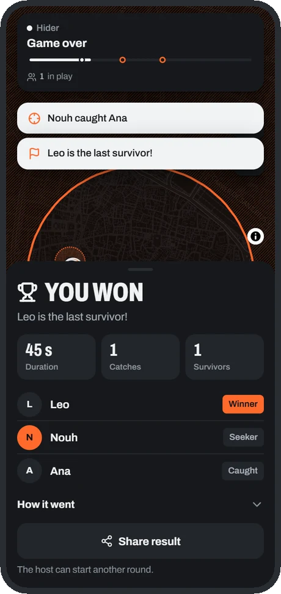

<p align="center">
  
</p>

<h1 align="center">SeekHunt</h1>

<p align="center">
  Escondite en la vida real desde el móvil, con una zona de juego que se cierra.
</p>

<p align="center">
  <a href="https://seekhunt.nouhk.workers.dev"><b>Jugar</b></a> ·
  <a href="docs/GAME_DESIGN.es.md">Diseño del juego</a> ·
  <a href="CONTRIBUTING.md">Contribuir</a> ·
  <a href="README.md">English</a>
</p>

<p align="center">
  <a href="https://github.com/NouhKhouyi/SeekHunt/actions/workflows/ci.yml"></a>
  <a href="LICENSE"></a>
</p>

Una persona busca, el resto se esconde, y la zona de juego se reduce cada
pocos minutos hasta que solo queda un superviviente. SeekHunt funciona en el
navegador del móvil: alguien crea una sala, coloca la zona sobre el barrio y
comparte el enlace. No hay que instalar nada ni crear una cuenta.

<p align="center">
  <picture>
    <source media="(prefers-color-scheme: dark)" srcset="docs/assets/gameplay-dark.gif">
    
  </picture>
  <br>
  <sub>El móvil de un escondido durante una partida corta, del inicio al resultado.</sub>
</p>

## Cómo es una partida

1. **Sala.** El anfitrión crea la sala, coloca el centro y el radio de la zona
   en el mapa, elige el ritmo y comparte el enlace.
2. **Escondite.** Los escondidos tienen ventaja mientras el cazador espera.
3. **Búsqueda.** Sale el cazador y la zona se cierra por fases. La siguiente
   zona siempre está a la vista. Quien sale de ella queda al descubierto y
   tiene un tiempo de gracia para volver.
4. **Capturas.** El cazador toca a un escondido y escanea el QR de su pantalla,
   o escribe sus cuatro cifras.
5. **Final.** Gana el último escondido, o todos los supervivientes si se acaba
   el tiempo. Todos ven un resumen y una imagen del resultado para compartir.

## Funciones

- **Zona que se cierra.** Cada zona cabe en la anterior y sale de una semilla
  común, así que todos los móviles ven los mismos círculos.
- **Radar.** Cada cierto tiempo el cazador ve una zona aproximada de cada
  escondido, y los escondidos ven a los cazadores. La precisión es configurable.
- **Capturas con QR.** Lector nativo en Android, lector WebAssembly propio en
  iPhone y entrada manual del código como alternativa.
- **Control del anfitrión.** Ritmos predefinidos, reglas, roles y una pausa que
  congela todos los tiempos.
- **Modos.** Último superviviente, infección y modo edificio.
- **Ayuda durante la partida.** Cuenta atrás antes de la salida, avisos de
  cierre y la dirección y distancia para volver a la zona.
- **Resumen.** Duración, capturas, supervivientes, cronología e imagen del
  resultado.
- **Idiomas.** Español e inglés, según el móvil.

<p align="center">
  
  
  
  
</p>

## Juego limpio, seguridad y privacidad

- **Decide el servidor.** Cada móvil solo recibe lo que su jugador puede ver.
- **Hay que encontrarse.** Una captura exige el código del escondido y, si los
  dos móviles tienen posición reciente, estar a unos 80 metros. Apagar el GPS
  propio no evita la comprobación, y los códigos erróneos repetidos activan una
  espera creciente.
- **Seguridad.** Consentimiento antes de pedir la ubicación, SOS para todos,
  pausa del anfitrión y recordatorio de jugar a pie.
- **Datos mínimos.** Solo se guarda la última posición de cada jugador y las
  salas se borran tras 12 horas sin actividad.

Las reglas completas están en el [documento de diseño](docs/GAME_DESIGN.es.md).

## Empezar

Requiere Node.js 22 o superior.

```bash
git clone https://github.com/NouhKhouyi/SeekHunt
cd SeekHunt
npm install
npm run dev        # worker en :8787 y web en :5173
```

- **Simulación:** abre <http://localhost:5173/?sim> en varias pestañas; tocar el
  mapa mueve a tu jugador.
- **Móviles en la misma red:** `npm run dev:phone` y abre
  `https://<tu-ip>:5173`, aceptando el aviso del certificado.
- **Despliegue:** `npx wrangler login` una vez y después `npm run deploy`.

## Contribuir

Lo más útil es jugar una partida y
[contar cómo fue](https://github.com/NouhKhouyi/SeekHunt/issues/new?template=playtest.yml).
Para código, consulta [CONTRIBUTING.md](CONTRIBUTING.md). Los problemas de
seguridad o privacidad se comunican en privado, según [SECURITY.md](SECURITY.md).

## Licencia

Publicado bajo la [licencia MIT](LICENSE). Datos del mapa © colaboradores de
[OpenStreetMap](https://www.openstreetmap.org/copyright); teselas de
[OpenFreeMap](https://openfreemap.org).
