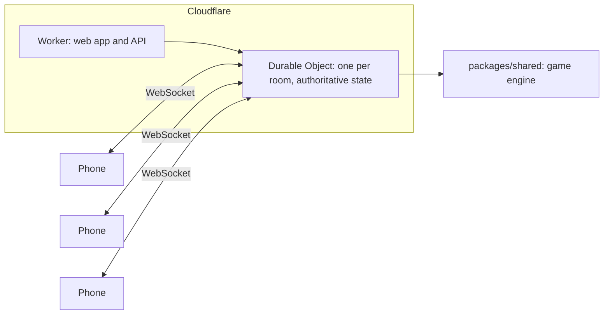

<p align="center">
  
</p>

<h1 align="center">SeekHunt</h1>

<p align="center">
  Real-life hide and seek on your phone, with a play zone that closes in.
</p>

<p align="center">
  <a href="https://seekhunt.nouhk.workers.dev"><b>Play</b></a> ·
  <a href="docs/GAME_DESIGN.md">Game design</a> ·
  <a href="CONTRIBUTING.md">Contributing</a> ·
  <a href="README.es.md">Español</a>
</p>

<p align="center">
  <a href="https://github.com/NouhKhouyi/SeekHunt/actions/workflows/ci.yml"></a>
  <a href="LICENSE"></a>
</p>

One player seeks, everyone else hides, and the play area shrinks every few
minutes until a single survivor is left. SeekHunt runs in the phone's browser:
one person creates a room, places the zone over the neighbourhood and shares
the link. There is nothing to install and no account to create.

<p align="center">
  <picture>
    <source media="(prefers-color-scheme: dark)" srcset="docs/assets/gameplay-dark.gif">
    
  </picture>
  <br>
  <sub>A hider's phone during a short game, from the head start to the result.</sub>
</p>

## How a game works

1. **Lobby.** The host creates a room, sets the zone's centre and radius on the
   map, picks a pace and shares the link. Players join from their browsers.
2. **Hiding.** Hiders get a head start while the seeker waits at the start.
3. **Seeking.** The seeker is released and the zone closes in stages. The next
   zone is always visible, so players can plan their route. Anyone who leaves
   the zone is revealed to the seeker and has a short grace period to return.
4. **Catching.** The seeker tags a hider and scans the QR code on their screen,
   or types its four digits.
5. **The end.** The last hider standing wins, or every survivor if time runs
   out. Everyone gets a recap of the game and a result image to share.

## Features

- **Shrinking zone.** Each zone fits inside the previous one and is derived
  from a shared seed, so every phone shows exactly the same circles.
- **Radar.** At a set interval the seeker sees an approximate area for each
  hider, and hiders see the seekers' positions. Precision is configurable.
- **QR catches.** Native barcode scanning on Android and a self-hosted
  WebAssembly scanner on iPhone, with manual code entry as a fallback.
- **Host controls.** Pace presets, game rules, role assignment and a pause that
  freezes every timer.
- **Game modes.** Last survivor, infection (caught players become seekers) and
  building mode, where players declare their floor.
- **Guidance in play.** A countdown before the release, notices when the zone
  closes, and a direction and distance back to the zone for anyone outside it.
- **Recap.** Duration, catches, survivors, a timeline of the game and a
  shareable result image.
- **Languages.** English and Spanish, chosen per device.

<p align="center">
  
  
  
  
</p>

## Fair play, safety and privacy

**The server decides.** Game rules run on the server, and each phone receives
only what its player is allowed to see. Hidden positions never reach the
browser.

**Catches need a real encounter.** A catch requires the hider's code and, when
both phones have a recent position, the players must be within about 80 metres
of each other. A seeker cannot skip that check by turning off their own GPS.
Repeated wrong codes trigger an increasing cooldown, so codes cannot be
guessed. Catches are refused above 25 km/h, and implausible GPS jumps are
discarded.

**Safety comes first.** Players consent before any location is requested. Any
player can send an SOS that reveals their position to everyone, the host can
pause the game at any time, and the app reminds players to stay on foot and
off roads.

**Minimal data.** Only each player's latest position is kept, and rooms are
deleted after 12 hours without activity.

The complete rules and the reasoning behind them are in the
[game design document](docs/GAME_DESIGN.md).

## Architecture



| Component | Technology |
|---|---|
| Client | React 19, Vite and TypeScript, packaged as an installable PWA |
| Map | MapLibre GL with OpenFreeMap tiles (no API key) |
| Real time | Cloudflare Workers and Durable Objects, with hibernating WebSockets and alarms as the game clock |
| Game rules | `packages/shared`, a pure engine shared by client and server and covered by tests |

```text
apps/web          progressive web app
apps/server       Worker and the GameRoom Durable Object
packages/shared   game engine, zones, geometry and protocol
scripts/          end-to-end and accessibility checks, artwork generation
docs/             game design
```

## Getting started

Requires Node.js 22 or later.

```bash
git clone https://github.com/NouhKhouyi/SeekHunt
cd SeekHunt
npm install
npm run dev        # Worker on :8787, web app on :5173
```

- **Simulation.** Open <http://localhost:5173/?sim> in several tabs. Tapping the
  map moves your player, so a full game can be played from one computer.
- **Phones on the same network.** Browsers only expose GPS and the camera on
  HTTPS pages. Run `npm run dev:phone` and open `https://<your-ip>:5173`,
  accepting the certificate warning.
- **Deployment.** With a Cloudflare account, run `npx wrangler login` once and
  then `npm run deploy`.

### Checks

```bash
npm run typecheck
npm test                       # game engine tests
node scripts/smoke.mjs         # a full game over WebSocket against the dev server
node scripts/a11y.mjs          # accessibility audit of every screen, light and dark
node scripts/qr-roundtrip.mjs  # verifies the scanner reads the catch QR code
```

## Roadmap

Planned work includes location-based questions answered by the server, player
abilities with limited charges, comeback mechanics for the final stages, and a
native wrapper so location keeps working with the screen locked. See the
[roadmap](docs/GAME_DESIGN.md#roadmap-from-competitor-research) for details.

## Contributing

Playtest reports are the most useful contribution: play a game and
[describe how it went](https://github.com/NouhKhouyi/SeekHunt/issues/new?template=playtest.yml).
For code changes, see [CONTRIBUTING.md](CONTRIBUTING.md). Please report
security or privacy issues privately, as described in [SECURITY.md](SECURITY.md).

## License

Released under the [MIT License](LICENSE). Map data ©
[OpenStreetMap](https://www.openstreetmap.org/copyright) contributors; tiles by
[OpenFreeMap](https://openfreemap.org) and [OpenMapTiles](https://openmaptiles.org).
