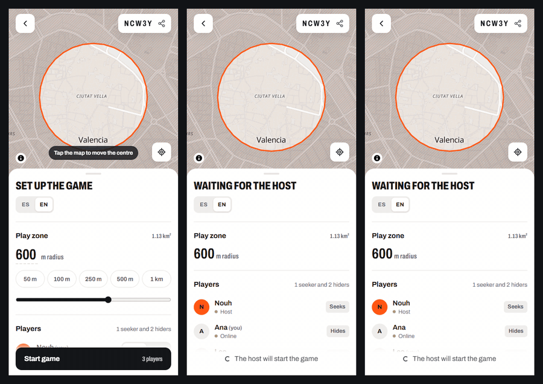
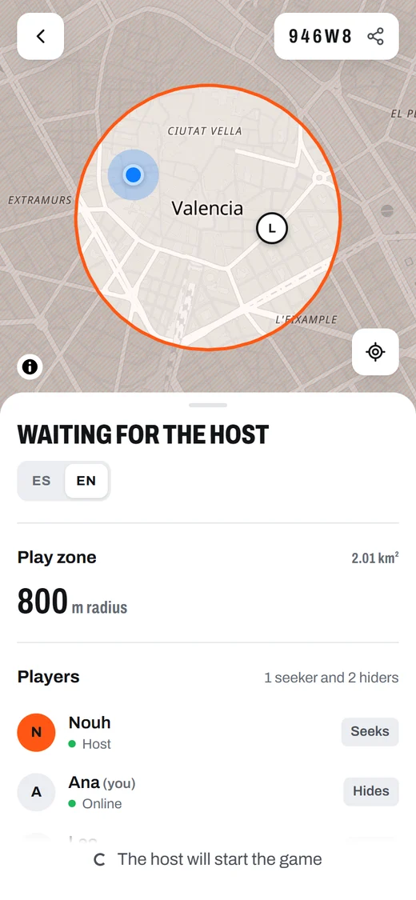
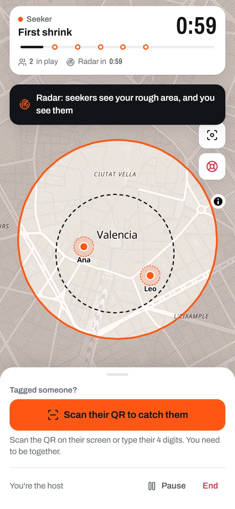
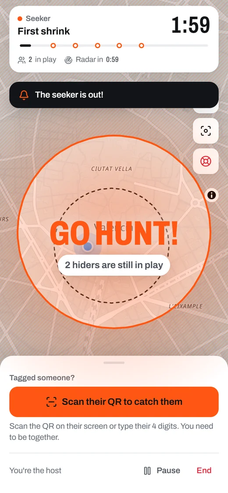
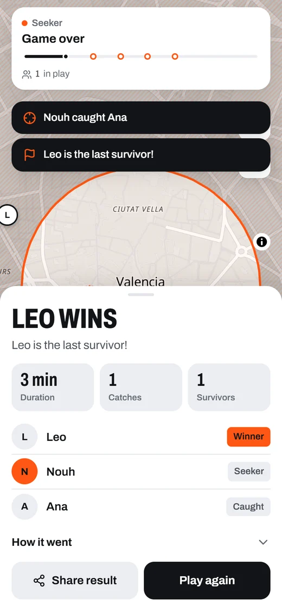
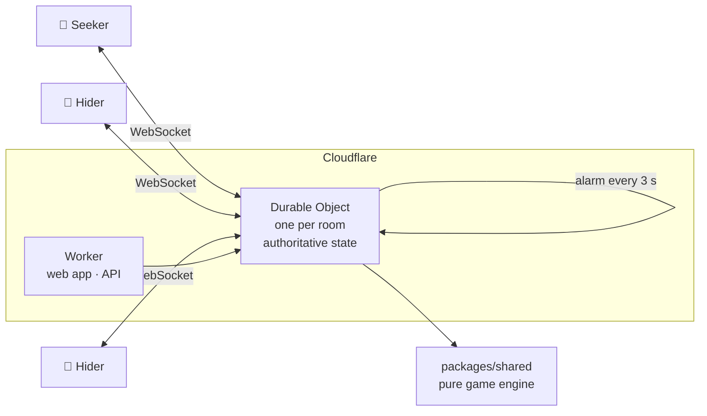

<p align="center">
  
</p>

<h1 align="center">SeekHunt</h1>

<p align="center">
  <b>Hide. The zone is closing.</b><br>
  Real-life hide and seek on your phone: one seeker, a zone that shrinks every
  few minutes, and a single survivor.
</p>

<p align="center">
  <a href="https://seekhunt.nouhk.workers.dev"></a>
</p>

<p align="center">
  <a href="https://github.com/NouhKhouyi/SeekHunt/actions/workflows/ci.yml"></a>
  <a href="LICENSE"></a>
  
  
  <a href="README.es.md"></a>
</p>

<p align="center">
  
  <br>
  <sub>Three phones playing one game, sped up. Left: the seeker. Middle and right: the hiders.</sub>
</p>

## 🏃 How to play

1. **Make a room.** One person creates a game, drags the zone over your
   neighbourhood and shares the link. Everyone joins from their phone's browser
   — no app store, no account.
2. **Hide.** Hiders get a head start while the seeker waits. Three, two, one…
   *the seeker is out*.
3. **Stay inside.** Every few minutes the zone closes in, battle-royale style.
   The next circle is always on the map, so you can plan your run. Step outside
   and you're revealed — get back in before the countdown ends.
4. **Get caught — properly.** The seeker has to tag you, then scan the QR code
   on your screen. GPS alone never decides a catch.
5. **Last one standing wins.** Then everyone gets the recap: who caught whom,
   when, and a result card to brag about.

## ✨ What's in the box

| | |
|---|---|
| 🎯 **A zone that closes in** | A real battle-royale schedule: every circle fits inside the last, computed from a seed so every phone sees exactly the same zone. |
| 📡 **Radar** | Every few minutes the seeker sees a rough circle around each hider — and hiders see the seekers. Fresh pings pulse like sonar. |
| 🔳 **QR catches** | Tag, scan, caught. Works on Android and iPhone, and you can type the 4-digit code if the camera won't cooperate. |
| 🎬 **Big moments** | A 3-2-1 before the release, *GO HUNT!*, and a banner every time the zone starts to close. |
| 🧭 **The way back** | Strayed outside? An arrow and the distance point you back to safety. |
| ⏸️ **Host pause** | Freezes every clock, the zone and the radar. Resume and the game carries on exactly where it was. |
| 🏆 **Recap and result card** | Duration, catches, a timeline of the game, and a shareable image of your game's real zones. |
| 🧟 **Infection mode** | Caught players join the hunt. Perfect for big groups. |
| 🏢 **Building mode** | Playing indoors? Players declare their floor and the radar shows it. |
| 🆘 **SOS** | One tap reveals you to everyone with an alert. Safety first, always. |
| 🌍 **English and Spanish** | Each phone shows the game in its own language — even in the same room. |

<p align="center">
  
  
  
  
</p>

## 🛡️ Fair and safe by design

**No cheating your way to a win.**

- **The server is the referee.** Each phone only ever receives what its player
  is allowed to see, so hidden positions can't be dug out of the browser.
- **You have to actually meet.** A catch needs the hider's code *and*, when
  both phones know where they are, the two of you within ~80 m. Switching your
  own GPS off doesn't skip the check.
- **No guessing codes.** Three wrong codes trigger a cooldown that keeps
  doubling, so trying all 10,000 would take days.
- **No cars.** Above 25 km/h you can't catch anyone, and impossible GPS jumps
  are thrown away.

**Built for playing in the street.**

- Location is only requested after a clear consent screen: what's shared, with
  whom and for how long.
- No history: only each player's latest position is kept, and rooms are
  deleted after 12 hours.
- SOS for everyone, a host pause, a reminder to play on foot, and a
  14+ / guardian rule.

Read the full rules, the balancing and the reasoning in the
[game design document](docs/GAME_DESIGN.md).

## 🧩 How it works



| Part | Tech |
|---|---|
| Client | React 19, Vite and TypeScript. An installable PWA that keeps the screen awake during a game. |
| Map | MapLibre GL with OpenFreeMap tiles — free, no API key. |
| Real time | Cloudflare Workers and **Durable Objects**: one instance per room, hibernating WebSockets, and alarms as the game clock. |
| Rules | `packages/shared`: a pure, server-authoritative game engine shared by client and server, with tests. |

```text
apps/web          the PWA
apps/server       the Worker and the GameRoom Durable Object
packages/shared   game engine, zones, geometry, protocol
scripts/          end-to-end smoke test, accessibility audit, artwork
docs/             game design
```

## 🚀 Run it yourself

You need Node.js 22 or newer.

```bash
git clone https://github.com/NouhKhouyi/SeekHunt
cd SeekHunt
npm install
npm run dev        # Worker on :8787, web app on :5173
```

**Play from one desk.** Open <http://localhost:5173/?sim> in a few tabs. In
simulation mode, tapping the map moves your player.

**Play with phones on your Wi-Fi.** Phones only give GPS and the camera to
`https` pages, so run `npm run dev:phone` and open `https://<your-pc-ip>:5173`
(accept the certificate warning).

**Deploy your own.** With a free Cloudflare account:

```bash
npx wrangler login   # once
npm run deploy       # builds the web app and publishes the Worker
```

<details>
<summary><b>Checks and tools</b></summary>

```bash
npm test                       # game engine tests
npm run typecheck
node scripts/smoke.mjs         # a full game over WebSocket against the dev server
node scripts/a11y.mjs          # axe accessibility audit of every screen, light and dark
node scripts/qr-roundtrip.mjs  # the scanner reads the catch QR (the iPhone zxing-wasm path)
node scripts/og-image.mjs      # regenerates the link-preview images
```

</details>

## 🗺️ What's next

Jet Lag–style questions answered by the server ("are you within 500 m?"),
abilities with charges (decoys, silence, an extra ping), comeback mechanics for
the final minutes, and a native wrapper so GPS keeps working with the screen
locked. The full roadmap is in the
[game design document](docs/GAME_DESIGN.md#roadmap-from-competitor-research).

## 🤝 Contributing

The best contribution is a game with friends and a
[playtest report](https://github.com/NouhKhouyi/SeekHunt/issues/new?template=playtest.yml).
For code, see [CONTRIBUTING.md](CONTRIBUTING.md). Found a way to see someone
you shouldn't? Please report it privately — see [SECURITY.md](SECURITY.md).

## 📄 License

[MIT](LICENSE). Map data © [OpenStreetMap](https://www.openstreetmap.org/copyright)
contributors, tiles by [OpenFreeMap](https://openfreemap.org) and
[OpenMapTiles](https://openmaptiles.org).

<p align="center"><sub>Made in Valencia by <a href="https://github.com/NouhKhouyi">Nouh Khouyi</a>. Go outside. 🧡</sub></p>
